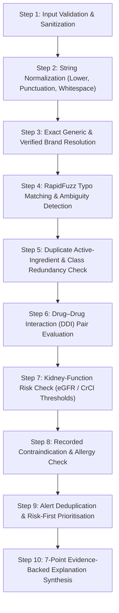

# H4 — The Medication Safety Second Pair of Eyes

> **Tagline:** *"Catch the right risks. Reduce unnecessary alerts. Explain every warning."*

[]()
[]()
[]()
[]()
[]()
[]()

---

## ⚠️ Important Clinical Disclaimer

> **CLINICAL DECISION-SUPPORT DEMONSTRATION PROTOTYPE ONLY**
> 
> **H4 — The Medication Safety Second Pair of Eyes** is an assistive software prototype developed strictly for decision-support research, demonstration, and hackathon evaluation.
> 
> - **Never independently prescribes, modifies, or discontinues medication.**
> - **Must never be used as a standalone or primary diagnostic or prescribing tool.**
> - **Not approved or cleared by the FDA, EMA, or any healthcare regulatory body for clinical deployment.**
> - All patients, identifiers, and scenarios demonstrated within this prototype are **synthetic or de-identified test records**.

---

## 1. System Architecture

The application is structured into a clean decoupled architecture: a high-performance **FastAPI (Python 3.12)** backend serving a rule-based deterministic clinical engine, and a modern **React 18 + TypeScript + Vite + Tailwind CSS** clinical decision cockpit.

```mermaid
graph TD
    subgraph Client["Clinical Decision Cockpit (React 18 + TypeScript)"]
        UI_Dash["1. Overview Dashboard"]
        UI_Patients["2. Patient Management & CSV/JSON Import"]
        UI_Checker["3. Interactive Safety Checker"]
        UI_Alerts["4. Triage & Alert Acknowledgement"]
        UI_Ref["5. Medicine & Rule Reference Catalogue"]
        UI_Eval["6. Evaluation & Benchmark Suite"]
        UI_Audit["7. Immutable Audit Trail"]
        UI_Settings["8. System Settings & Compliance"]
    end

    subgraph API["FastAPI REST Services (/api)"]
        Router["API Router & Middleware"]
        Pydantic["Pydantic v2 Schema Validation"]
    end

    subgraph CoreEngine["Clinical Decision-Support Core Engine"]
        Resolver["Core Innovation A:<br/>Multi-Tier Medicine Resolver<br/>(Exact, Brand, RapidFuzz Typo, Ambiguity Flag)"]
        Pipeline["10-Step Deterministic Rules Engine"]
        Prioritiser["Core Innovation B:<br/>Risk-First Prioritisation & Deduplication Engine"]
        Explainer["Core Innovation C:<br/>7-Point Grounded Evidence Generator"]
        Evaluator["Benchmark Evaluator<br/>(Recall, Precision, Near-Miss, Alert Fatigue)"]
    end

    subgraph DataStore["Persistence Layer (SQLAlchemy 2.0)"]
        DB[(SQLite / PostgreSQL Compatible DB)]
        Catalogue[("Medicine Catalogue & Verified Brand Mappings")]
        RulesStore[("CPIC / FDA Interactions, KDIGO Renal, Contraindications")]
        PatientStore[("Synthetic Patient Cohort & Medication Lists")]
        AlertStore[("Safety Alerts, Acknowledgements & Audit Logs")]
    end

    Client <-->|REST / JSON (Axios Client)| API
    API --> CoreEngine
    CoreEngine --> DataStore
```

---

## 2. The 10-Step Medication Safety Pipeline



---

## 3. Core Innovations

### 🌟 Core Innovation A: Smart Multi-Tier Medicine Resolver
Clinical entry often includes brand names (e.g., *Glucophage*), synonyms, or typos (e.g., *Metfornin*). 
- **Tier 1 (Exact Generic):** Deterministic case-insensitive matching against curated INN generic names.
- **Tier 2 (Verified Brand):** Resolves verified brand names to their authoritative active pharmaceutical ingredient(s).
- **Tier 3 (RapidFuzz Typo Matching):** Uses normalized token-sort Levenshtein scoring. Scores $\ge 82\%$ surface candidate generic matches.
- **Ambiguity Guardrail:** If multiple generic candidates have similar proximity scores, the system **never guesses silently**; it flags `requires_confirmation = true` and surfaces selectable options to the clinician.
- **Confidence Decoupling:** Medicine-name resolution confidence is strictly reported separately from clinical risk severity.

### 🛡️ Core Innovation B: Risk-First Alert Prioritisation & Deduplication
To combat life-threatening **alert fatigue**:
- **Severity-First Ordering:** Alerts are ranked strictly by reference-defined risk (`HIGH` $\to$ `MEDIUM` $\to$ `LOW`).
- **Semantic Deduplication:** Multiple alerts pointing to the same underlying clinical pair or mechanism are consolidated into a single actionable card with grouped references.
- **Insufficient Information Flags:** Missing renal lab values or clinical context produce explicit `Missing Information` warnings rather than silently suppressing risks or assuming zero risk.

### 📋 Core Innovation C: 7-Point Grounded Evidence Explanations
Every generated alert includes a structured, fully explainable 7-point clinical dossier:
1. **Detected Issue:** Precise clinical classification (e.g., *Major Drug-Drug Interaction: Anticoagulant + Antiplatelet*).
2. **Medicines Involved:** Exact medications and active ingredients implicated.
3. **Clinical Rationale:** Pharmacodynamic or pharmacokinetic mechanism.
4. **Authoritative Reference:** Formal guideline source (e.g., *CPIC Guidelines*, *FDA Package Insert*, *KDIGO 2024*).
5. **Missing Information:** Explicit callout of unrecorded lab values (e.g., *Current INR or baseline bleeding assessment missing*).
6. **Clinician Action:** Objective recommendation (e.g., *Evaluate bleeding risk; consider gastroprotection; review indication*).
7. **Confirmation Status:** Clear badge distinguishing deterministic rule match from fuzzy-matched review.

---

## 4. Pre-Seeded Synthetic Demo Cohort

The database initialises automatically with 7 distinct synthetic test cases designed to demonstrate every challenge requirement:

| Patient ID | Name | Case Profile | Expected Safety Findings |
|---|---|---|---|
| `SYN-001` | Robert Vance (68M) | **Warfarin + Aspirin** | **HIGH Severity DDI:** Synergistic bleeding risk (CPIC / FDA). |
| `SYN-002` | Eleanor Rigby (54F) | **Glucophage + Metformin** | **HIGH Severity Duplicate:** Brand (*Glucophage*) + Generic (*Metformin*) active ingredient redundancy. |
| `SYN-003` | Arthur Dent (62M) | **"Metfornin" (Typo) + Lisinopril** | **Resolver Match:** RapidFuzz resolves typo to *Metformin* with 94.7% confidence; executes safety rules. |
| `SYN-004` | Chloe Decker (39F) | **"Amlo" (Ambiguous Entry)** | **Ambiguity Flag:** Prompts clinician confirmation between *Amlodipine* vs. *Amiloride*. |
| `SYN-005` | Walter White (71M) | **Metformin + eGFR 24 mL/min** | **HIGH Severity Renal Risk:** Contraindicated at eGFR < 30 mL/min/1.73m² (Lactic acidosis risk, KDIGO 2024). |
| `SYN-006` | Sarah Connor (45F) | **Lisinopril + Unrecorded Creatinine** | **Missing Data Warning:** Explicit notification that kidney function lab is unrecorded for ACE-inhibitor. |
| `SYN-007` | Bruce Wayne (38M) | **Atorvastatin + Omeprazole** | **Clean Medication List:** Zero safety contraindications or interactions identified under supported rules. |

---

## 5. Main Navigation Modules

1. **Overview Dashboard:** Live KPI cards (patients, analyses, unresolved alerts, fuzzy matches), alert distribution charts, recent activity log, and dataset status banner.
2. **Patient Records:** Patient directory with search, condition/allergy filters, detailed clinical profile modal, and working **CSV/JSON Import & Export**.
3. **Medication Safety Checker:** Live testing harness allowing clinicians to select existing patients or build ad-hoc medication lists with instant 10-step safety analysis.
4. **Medication Alerts:** Triage queue with multi-dimensional filtering, 7-point evidence dossier viewer, and persistent **clinician acknowledgement & note taking**.
5. **Medicine Reference:** Searchable browser of 40+ drugs, verified brand aliases, DDI interaction rules, and KDIGO renal thresholds.
6. **Evaluation & Testing:** Live validation suite running benchmark datasets; generates **Recall, Precision, Near-Miss Recall, Confusion Matrix, and Alert Fatigue Reduction** comparisons.
7. **Audit History:** Tamper-evident chronological audit log recording every analysis, acknowledgement, and import.
8. **Settings & About:** Reference data provenance, clinical disclaimers, system health diagnostics, and environment toggles.

---

## 6. Installation & Quick Start

### Prerequisites
- **Python:** 3.11+ (Python 3.12 recommended)
- **Node.js:** v18+ or v20+ LTS

### Backend Setup

```bash
# 1. Clone repository & enter workspace
cd healthcare

# 2. Create and activate virtual environment
python -m venv .venv

# On Windows (PowerShell):
.\.venv\Scripts\Activate.ps1
# On Linux/macOS:
source .venv/bin/activate

# 3. Install dependencies
pip install fastapi uvicorn sqlalchemy pydantic pandas rapidfuzz pytest httpx python-multipart

# 4. Initialize database and load demo data
python -m backend.app.seed_demo

# 5. Start the backend API server
python -m uvicorn backend.app.main:app --host 127.0.0.1 --port 8000 --reload
```
The backend API is now running at **http://127.0.0.1:8000** with interactive Swagger docs at **http://127.0.0.1:8000/docs**.

### Frontend Setup

```bash
# In a new terminal:
cd healthcare/frontend

# 1. Install dependencies
npm install

# 2. Start Vite development server
npm run dev -- --host 127.0.0.1 --port 5173

# 3. (Optional) Compile production bundle
npm run build
```
Open your browser to **http://127.0.0.1:5173** to access the dashboard.

---

## 7. Automated Test Suite

Run the comprehensive pytest suite covering the resolver, rules engine, alert prioritiser, and REST endpoints:

```bash
# In the project root with .venv activated:
pytest backend/tests/ -v
```

### Verified Test Results
```text
============================= test session starts =============================
platform win32 -- Python 3.12.15, pytest-9.0.2
collected 18 items

backend/tests/test_api.py::test_health_check PASSED                    [  5%]
backend/tests/test_api.py::test_dashboard_summary PASSED               [ 11%]
backend/tests/test_api.py::test_patients_crud PASSED                   [ 16%]
backend/tests/test_api.py::test_resolver_endpoint PASSED               [ 22%]
backend/tests/test_api.py::test_safety_checker_endpoint PASSED         [ 27%]
backend/tests/test_api.py::test_alert_acknowledgement PASSED           [ 33%]
backend/tests/test_api.py::test_evaluation_run PASSED                  [ 38%]
backend/tests/test_prioritiser.py::test_prioritiser_sorts_by_severity PASSED [ 44%]
backend/tests/test_prioritiser.py::test_prioritiser_deduplication PASSED [ 50%]
backend/tests/test_resolver.py::test_exact_generic_resolution PASSED    [ 55%]
backend/tests/test_resolver.py::test_verified_brand_resolution PASSED   [ 61%]
backend/tests/test_resolver.py::test_fuzzy_misspelling_resolution PASSED [ 66%]
backend/tests/test_resolver.py::test_ambiguous_short_name_flagged PASSED [ 72%]
backend/tests/test_rules_engine.py::test_drug_drug_interaction_detected PASSED [ 77%]
backend/tests/test_rules_engine.py::test_duplicate_active_ingredient_detected PASSED [ 83%]
backend/tests/test_rules_engine.py::test_renal_risk_detected PASSED     [ 88%]
backend/tests/test_rules_engine.py::test_contraindication_detected PASSED [ 94%]
backend/tests/test_rules_engine.py::test_missing_renal_data_warned PASSED [100%]

============================== 18 passed in 1.78s ==============================
```

---

## 8. REST API Documentation

| Method | Endpoint | Description |
|---|---|---|
| `GET` | `/api/health` | Health check & service status |
| `GET` | `/api/dashboard/summary` | Real-time dashboard KPI summary |
| `GET` | `/api/patients` | List patients with search & condition filters |
| `POST` | `/api/patients` | Create a new patient record |
| `POST` | `/api/patients/import/csv` | Batch import synthetic patient CSV |
| `GET` | `/api/patients/export/csv` | Export safe de-identified CSV |
| `POST` | `/api/resolver/resolve` | Smart medicine resolution sandbox |
| `POST` | `/api/checker/analyze` | Execute 10-step medication safety analysis |
| `GET` | `/api/alerts` | List all safety alerts with severity filters |
| `POST` | `/api/alerts/{id}/acknowledge` | Clinician acknowledgement with notes |
| `GET` | `/api/reference/medicines` | Query authoritative medicine catalogue |
| `POST` | `/api/evaluation/run` | Execute benchmark evaluation suite |
| `GET` | `/api/audit/logs` | Query immutable audit events |

---

## 9. Security, Privacy & Compliance

- **Synthetic Identifiers Only:** All test patients utilize synthetic identifiers (`SYN-XXX`) to completely prevent Protected Health Information (PHI) exposure.
- **CSV Formula Injection Shielding:** Patient CSV exports strictly sanitize cell prefixes (`=`, `+`, `-`, `@`) to block spreadsheet formula injection attacks.
- **No Hardcoded Credentials:** Zero secrets in frontend; configurable via `.env.example`.
- **Foreign Key Integrity:** Database migrations enforce relational foreign key cascading and schema constraints.
- **Offline Reliability:** Operates with 100% offline autonomy using embedded deterministic reference tables—no external API dependencies required.

---

## 10. License

Developed for the **H4 Healthcare Clinical Decision-Support Hackathon**. Distributed under the MIT Prototype License. Not approved for clinical use.
